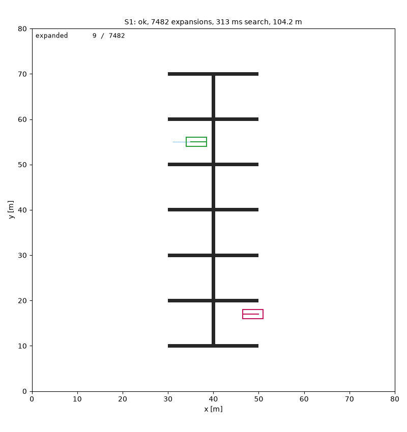
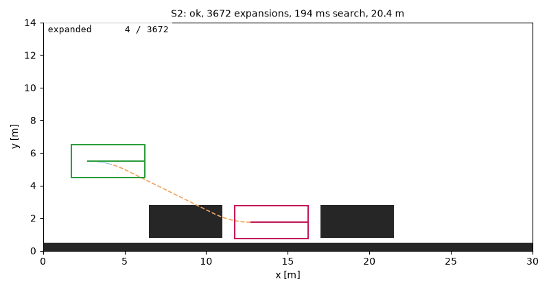
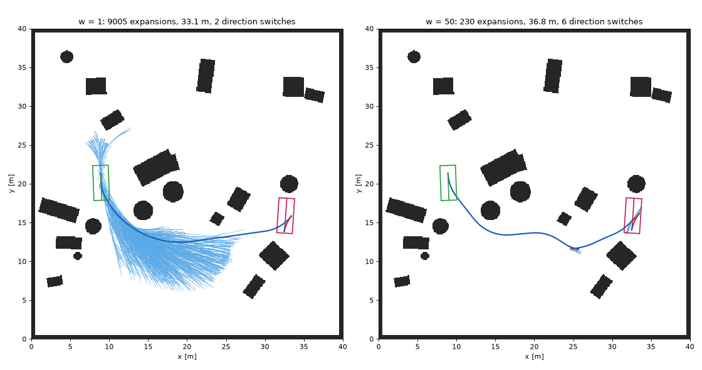

# Hybrid A* path planner

A Hybrid A* planner for a car-like vehicle on an occupancy grid, written in
C++, with Python bindings and matplotlib plots and animations of the search.



Blue lines are the search tree, dashed orange lines are Reeds-Shepp shots at
the goal that hit something, blue is forward driving and red is reverse.

## What it does

- Searches over (x, y, heading) with motion primitives: 0.5 m arcs at 5
  steering angles, forward and in reverse, for a car with a 2.5 m wheelbase,
  0.45 rad max steer (5.17 m turning radius) and a 4.5 x 2.0 m footprint.
- Heuristic: the larger of the 2D distance to the goal around obstacles and
  the obstacle-free Reeds-Shepp length.
- Analytic expansion: every 10 expansions, and on every expansion once it is
  within 10 m, it tries the shortest Reeds-Shepp curve to the goal. When one
  is collision-free the search stops, so the path ends exactly on the goal
  pose.
- Collision checks: four covering circles against a distance map first,
  then an exact check of every grid cell under the car for poses the circles
  reject.
- Smoothing: each stretch between direction changes is smoothed on its own,
  keeping clear of obstacles and within the turning radius. Start, goal and
  cusps do not move.
- All parameters are in `config/params.yaml`.

## v1 and why ROS is gone

v1 was a ROS 2 package; it is kept at the tag `v1-ros2`. ROS only carried
data from the C++ planner to a Python script that animated the result: the
planner ran once and published the path, and nothing was live. That does not
need ROS, so v2 is a plain CMake project. The planner is a library, there is
a command line tool that writes CSV, and Python calls the planner directly
through pybind11.

Apart from that, v2 fixes a number of things in v1: the Reeds-Shepp
expansion was declared but never written, so v1 stopped anywhere within
0.5 m and 0.3 rad of the goal; headings were never wrapped; there was no
smoothing; params.yaml was never read; the car turned about its centre
instead of its rear axle; and the collision check could miss cells under
the car. `docs/RESULTS.md` has the details and the v1 vs v2 numbers.

## Building

Ubuntu 24.04:

```bash
sudo apt install cmake ninja-build g++ libompl-dev libeigen3-dev libgtest-dev python3-dev python3-venv \
    libboost-serialization-dev libboost-filesystem-dev libboost-system-dev
tools/setup_venv.sh        # .venv with numpy, matplotlib, PyYAML, pytest
cmake -S . -B build -G Ninja -DCMAKE_BUILD_TYPE=Release -DPython_EXECUTABLE=$PWD/.venv/bin/python
cmake --build build
ctest --test-dir build
.venv/bin/python -m pytest python/tests
```

CMake fetches pybind11 (v2.13.6) itself. The Python module is built into
`python/`, and `setup_venv.sh` puts that folder on the venv's path, so
`import hybrid_astar` works in the venv after the build. `-DBUILD_PYTHON=OFF`
skips it.

## Command line

```bash
build/hybrid_astar_cli --scenario scenarios/S2.txt --out path.csv
build/hybrid_astar_cli --scenario scenarios/S1.txt --set heuristic_weight=1 --trace trace.csv
build/hybrid_astar_cli --help
```

A scenario is a PGM image (black = obstacle) plus a small text file with the
resolution and the start and goal poses. Poses are the rear axle, headings
in degrees. `tools/make_scenarios.py` writes the ones in `scenarios/`.

## Python

```python
import numpy as np
import hybrid_astar as ha
from hybrid_astar_viz import plot_result

grid = np.zeros((300, 400), dtype=np.int8)   # row 0 is the bottom, 0.1 m cells
grid[:200, 195:205] = 100                     # a wall with a gap at the top
cfg = ha.load_config("config/params.yaml")

r = ha.plan(grid, (5.0, 5.0, 0.0), (35.0, 5.0, 0.0), cfg, resolution=0.1)
print(r.success, r.stats.expansions, r.stats.search_ms)
print(r.x[:3], r.direction[:3])               # numpy arrays; direction is +1 / -1

plot_result(ha.GridMap(grid, 0.1), r, cfg, start=(5, 5, 0), goal=(35, 5, 0), out="plan.png")
```

`ha.plan(..., record_trace=True)` adds the search trace for
`hybrid_astar_viz.animate_search`, and `on_progress=callback, every=N` calls
back with new nodes during the search. `ha.Planner` keeps one map set up for
many plans. `tools/demo.py S1` writes a picture and an animation for one
scenario.

## Results

Release build on an i7-10870H, default parameters, commit `fb06823`. S1-S4
were planned 20 times each and S5 once on each of 50 random maps.

| scenario | success | search ms median | search ms p95 | expansions | length m | direction switches |
|---|---|---|---|---|---|---|
| S1 demo map | 20/20 | 306 | 329 | 7482 | 104.2 | 3 |
| S2 parallel parking | 20/20 | 120 | 123 | 2578 | 21.8 | 5 |
| S3 dead end | 20/20 | 14 | 15 | 10 | 29.4 | 1 |
| S4 maze | 20/20 | 204 | 217 | 6220 | 93.3 | 4 |
| S5 random, 50 maps | 50/50 | 27 | 67 | 196 (median) | 35.5 (median) | 1 (median) |

Against v1 on the same maps, v1 solves S1, S3, S4 and 39 of the 50 S5 maps,
fails S2, and ends 0.35 to 0.47 m away from the goal. v2 solves all of them
and ends on the goal pose. Smoothing takes 2 to 10 ms, and the smoothed
paths stay under 1.05 times the full-steer curvature.



`heuristic_weight` (default 5) trades path cost for speed: 1 is plain A*,
larger values expand fewer nodes but accept longer paths with more direction
changes. With w = 1 only S3 and the S5 maps finish within 200000
expansions. The picture below is the same S5 map with w = 1 and w = 50.



More numbers, and the commands that produce them, are in
[docs/RESULTS.md](docs/RESULTS.md). The pictures are in `results/v2/`.

## Own code and libraries

The search, heuristics, collision checks, distance transform, smoother and
plotting are written here. OMPL is used only for the Reeds-Shepp curves
(`ompl::base::ReedsSheppStateSpace`, wrapped in `src/reeds_shepp.cpp`), and
pybind11 only for the Python bindings.

## Limitations

- With weight 5 the paths are not the shortest. On S1 the car backs up most
  of the 104 m instead of turning around first.
- The car must fit in a slot of its length + 1.2 m to park in it. The
  car + 1.0 m slot in `scenarios/S2_tight` cannot be solved; RESULTS.md
  shows why.
- The smoother gains very little clearance, because the tightest spots are
  usually the goal and the cusps, which it does not move.
- The 2D distance part of the heuristic runs Dijkstra over the full-resolution
  grid for every goal, and the Reeds-Shepp length is computed for every new
  node. On large maps these are a large part of the time.
- Static maps only, one thread, a rectangular footprint, and no speed or
  steering-rate limits.

## Layout

```
include/hybrid_astar/   headers
src/                    planner, collision, smoother, Reeds-Shepp wrapper, CLI
python/                 bindings, hybrid_astar_viz (plots, animation), tests
tests/                  GoogleTest
tools/                  scenario generator, benchmark, v1 comparison, media, demo
scenarios/              S1-S5
config/params.yaml      parameters
results/v2/             pictures, animations and benchmark data
results/pathviz.gif     the v1 animation
```
