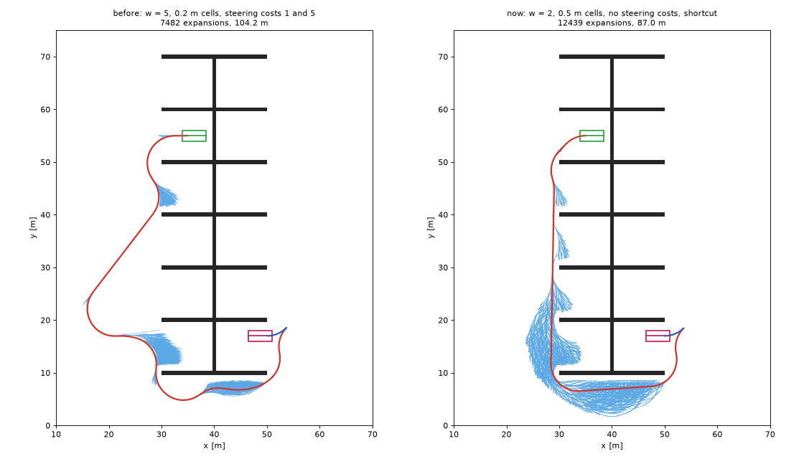

# Results

All numbers here come from runs of committed code on one machine:

- CPU: Intel Core i7-10870H (8 cores, the planner uses one)
- Ubuntu 24.04, kernel 6.8, g++ 13.3.0, `CMAKE_BUILD_TYPE=Release`
- OMPL 1.5.2, pybind11 2.13.6

Most sections were measured at commit `a4bc295`. The v1 comparison, the
steering cost rows and the S2_tight runs were measured at `a77bc6f`, which
only adds path lengths to `tools/compare_v1.py` and a check on `--label` in
the CLI; the planner is the same. The collision benchmark is from `fb06823`;
the collision code has not changed since. Each section says which one.

The raw CSVs and summary tables are in `results/v2/data/`, and
`machine_<sha>.txt` there records the commit, date, CPU and compiler. To
repeat them:

```bash
git checkout a4bc295
cmake -S . -B build -G Ninja -DCMAKE_BUILD_TYPE=Release -DPython_EXECUTABLE=$PWD/.venv/bin/python
cmake --build build
tools/benchmark.py --repeat 20 --stats benchmark.csv
for w in 1 1.5 2 3 5 50; do tools/benchmark.py --stats weight_sweep.csv --label "w=$w" --set heuristic_weight=$w; done
for r in 0.2 0.3 0.4 0.5 0.75 1.0; do tools/benchmark.py --stats cell_sweep.csv --label "xy_resolution=$r" --set xy_resolution=$r; done
for rp in 1.5 10; do for dc in 5 150; do
  tools/benchmark.py --stats cost_sweep.csv --label "rp=$rp dc=$dc" \
    --set reverse_penalty=$rp --set direction_change_cost=$dc; done; done
for h in 0 1; do tools/benchmark.py --stats rs_heuristic.csv --label "rs_heuristic=$h" --set rs_heuristic=$h; done
for m in 0 1 2; do tools/benchmark.py --stats collision_modes.csv --label "collision_mode=$m" --set collision_mode=$m; done
tools/benchmark.py --stats postprocess.csv --label off --set shortcut_enabled=0 --set smooth_enabled=0
tools/benchmark.py --stats postprocess.csv --label "shortcut only" --set smooth_enabled=0
tools/benchmark.py --stats postprocess.csv --label "smoothing only" --set shortcut_enabled=0
tools/make_media.py
git checkout a77bc6f && cmake --build build
tools/benchmark.py --stats steering.csv --label "steering costs 1 and 5" --set steer_cost=1 --set steer_change_cost=5
tools/compare_v1.py --v1-cli <v1 build>/hybrid_astar_cli --out v1_vs_v2.csv
```

The search settings table runs `tools/benchmark.py` once per row with the
`--set` values given in the table. `tools/benchmark.py --summary-only
FILE.csv` prints a summary table from a CSV. For the v1 build I check out
`7719e2a` in a separate worktree and build `hybrid_astar_cli` there.

## Scenarios

| | map | what it tests |
|---|---|---|
| S1 | 80 x 80 m, 0.1 m cells | the demo map from v1's `env_publisher.py` |
| S2 | 30 x 14 m | parallel parking, slot = car length + 1.5 m |
| S2_tight | same, slot = car length + 1.0 m | a slot the search cannot park in, see below |
| S3 | 40 x 30 m | 6 m wide dead end, the car has to back out |
| S4 | 40 x 40 m | 5x5 maze, 7.6 m corridors |
| S5 | 40 x 40 m, 50 seeds | 14 random boxes and 6 discs, random start and goal at least 20 m apart |

`tools/make_scenarios.py` writes all of them. Poses are the rear axle.

## Benchmark (default parameters)

Commit `a4bc295`. S1-S4 planned 20 times each, S5 once per seed. "search
ms" is the search only; the distance map is built once per map before it
(about 4 ms for the 40 x 40 m maps). "shortcut ms" and "smooth ms" are the
two steps after the search. Curvatures are in 1/m; full steer is
1/R_min = 0.1932, and 1.05 / R_min = 0.2029. Clearance is from the car
footprint to the nearest occupied cell centre, over the whole path.

| scenario | runs | success | search ms median | search ms p95 | shortcut ms median | smooth ms median | expansions | length m | direction switches | max curvature | min clearance m | stretches put back |
|---|---|---|---|---|---|---|---|---|---|---|---|---|
| S1 | 20 | 20/20 | 560.6 | 723.9 | 13.6 | 12.4 | 12439 | 87.0 | 1 | 0.1975 | 0.07 | 0 |
| S2 | 20 | 20/20 | 205.9 | 232.6 | 0.4 | 3.1 | 3672 | 20.4 | 4 | 0.1988 | 0.06 | 0 |
| S3 | 20 | 20/20 | 19.9 | 22.3 | 0.7 | 3.9 | 40 | 29.7 | 1 | 0.1971 | 0.11 | 0 |
| S4 | 20 | 20/20 | 260.2 | 316.9 | 6.5 | 10.9 | 6810 | 92.3 | 2 | 0.2002 | 0.07 | 0 |
| S5 | 50 | 50/50 | 29.8 | 62.7 | 2.7 | 4.6 | 116 (median) | 33.0 (median) | 1 (median) | 0.2028 (worst) | 0.05 (worst) | 2 |

S2_tight: no path, the open set is empty after 62531 expansions (2.8 s).

The search is deterministic, so repeated runs give the same path. "Stretches
put back" counts the pieces between cusps where the smoothed version broke a
limit and the shortcut one was kept.

On every successful run the final path stays under 1.05 / R_min (largest
value 0.2028, which is 1.0498 / R_min), every pose is free in the exact
collision check, and the start, goal and cusp poses are the ones the search
found. The unit tests check all of this on S1-S4 and one S5 seed. The path
ends on the goal pose: the largest error over all runs is 1e-14 m and
9e-16 rad.

## Why the S1 path used to be 104 m

At `fb06823` the S1 path was 104.2 m: it swung out to x = 16 and looped
before coming back to the bars. v1 found a shorter one. Three things caused
it:

1. `steer_cost` (1 per rad) and `steer_change_cost` (5 per rad of change)
   are charged once per primitive. v1 used 1 m primitives; I had gone to
   0.5 m, so per metre they doubled, and a full-steer turn cost almost twice
   as much as driving straight. The heuristic only knows distance, so it
   badly underestimated the real cost, and plain A* (w = 1) ran out of
   expansions on S1, S2 and S4.
2. To make it finish I had raised the heuristic weight to 5. At w = 5 the
   search mostly follows the heuristic and takes the first path it reaches.
3. With 0.2 m closed-set cells and 0.5 m steps the search can reach nearly
   the same pose many times, so it expands far more nodes than it needs.

Changing one setting at a time, at `a4bc295`, one run each (S5: medians
over 50 seeds):

| settings | S1 | S2 | S4 | S5 success | S5 length m |
|---|---|---|---|---|---|
| `fb06823` defaults: w = 5, 0.2 m cells, steering costs 1 and 5 | 7482 exp, 104.2 m | 2578 exp, 21.8 m | 6220 exp, 93.3 m | 50/50 | 35.5 |
| steering costs 0 | 9370 exp, 95.4 m | 1870 exp, 23.3 m | 16080 exp, 109.1 m | 50/50 | 33.8 |
| + w = 2 | 46831 exp, 87.7 m | 16103 exp, 20.5 m | 17000 exp, 93.8 m | 50/50 | 33.4 |
| + 0.5 m cells | 12439 exp, 88.3 m | 3672 exp, 20.5 m | 6810 exp, 93.0 m | 50/50 | 33.3 |
| + shortcut pass (the new default) | 12439 exp, 87.0 m | 3672 exp, 20.4 m | 6810 exp, 92.3 m | 50/50 | 33.0 |



The shortcut pass is new. With no steering cost the search zig-zags between
steering angles that cost the same; on S1 the long reverse run snaked from
side to side. The smoother cannot fix that: it moves the path locally, and
straightening an 80 m run means moving all of it sideways, away from the bar
ends. The shortcut pass runs before the smoother. Within each run between
cusps it takes poses 0.5 m apart and, from each, joins the farthest later
one it can reach with a Reeds-Shepp curve that is shorter than the path it
replaces, collision free, and drives in the same direction. Start, goal and
cusps stay where they are, so the path can only get shorter. On S1 it takes
12 to 14 ms, and the total heading change along the path drops from 789 to
418 degrees.

The new S1 path still drives most of the way (83 m) in reverse. That is the
shortest way: the car starts nose-in to the slot at (35, 55) and has to end
nose-in to the slot at (50, 17), facing the other way, and backing all the
way round turns it without the extra metres of turning round. v1's path
reverses 84 of its 88 m too (`results/v2/baseline_v1_S1.csv`). "Shortest is
not cheapest" below explains when the planner turns the car round instead.

## v1 vs v2

`tools/compare_v1.py` at `a77bc6f`, with v1 built from `7719e2a` (the v1
planner with ROS taken out and nothing else changed). Each scenario is
planned once. v1 has no expansion limit, so it gets 30 s and 4 GB per run.
v1 puts the centre of the car on the pose, so it gets the poses moved 1.25 m
forward: the same physical start and goal.

Times are the whole call. For v1 that includes building its unused k-d
tree; for v2 the distance map, the search, the shortcut and the smoother.
Lengths are of the path each version returns (v1: the car centre, v2: the
rear axle). S5 lengths are over the 39 seeds both solve.

| scenario | version | success | time ms | length m | goal position error m | goal heading error rad |
|---|---|---|---|---|---|---|
| S1 | v1 | 1/1 | 371.3 | 94.0 | 0.376 | 0.143 |
| S1 | v2 | 1/1 | 586.8 | 87.0 | 0 | 0 |
| S2 | v1 | 0/1 | 16244.5 | - | - | - |
| S2 | v2 | 1/1 | 199.2 | 20.4 | 9e-16 | 6e-17 |
| S3 | v1 | 1/1 | 2425.4 | 36.0 | 0.467 | 0.243 |
| S3 | v2 | 1/1 | 31.9 | 29.7 | 2e-15 | 0 |
| S4 | v1 | 1/1 | 611.7 | 109.0 | 0.345 | 0.218 |
| S4 | v2 | 1/1 | 264.1 | 92.3 | 0 | 0 |
| S5 (median) | v1 | 39/50 | 749.7 | 38.0 | 0.381 | 0.179 |
| S5 (median) | v2 | 50/50 | 41.4 | 32.9 | 2e-15 | 0 |

v1 cannot reach the exact goal: it stops anywhere within 0.5 m and 0.3 rad.
On S2 it searches the whole space and finds nothing (open set empty after
16 s). All 11 S5 failures hit the 30 s limit. v2's paths are shorter on
every scenario both solve. On S1 v2 takes longer than v1 (587 against
371 ms); that is the price of w = 2 instead of v1's w = 50.

`results/v2/baseline_v1_S1.csv` is the S1 path from `7719e2a` with the
original v1 poses (the car centre on the start pose, not the rear axle), so
its 88.0 m is for a slightly different start and goal than the 94.0 m above.

## Heuristic weight

`heuristic_weight` multiplies the heuristic, so w = 1 is plain A* and w > 1
expands fewer nodes but accepts more expensive paths. `a4bc295`, one run
per scenario (50 for S5). "fail" means no path: either 200000 expansions or
an empty open set.

| w | S1 | S2 | S3 | S4 | S5 success | S5 expansions median | S5 length m median | S5 switches median | S5 search ms median / p95 |
|---|---|---|---|---|---|---|---|---|---|
| 1 | 135920 exp, 91.7 m | 34416 exp, 20.8 m | 280 exp, 29.4 m | 15370 exp, 89.5 m | 50/50 | 1023 | 32.5 | 1 | 65.0 / 257.4 |
| 1.5 | 89780 exp, 91.7 m | fail | 40 exp, 29.4 m | 15430 exp, 90.9 m | 50/50 | 230 | 33.0 | 1 | 30.4 / 137.4 |
| 2 | 12439 exp, 87.0 m | 3672 exp, 20.4 m | 40 exp, 29.7 m | 6810 exp, 92.3 m | 50/50 | 116 | 33.0 | 1 | 27.5 / 62.6 |
| 3 | 2203 exp, 88.3 m | fail | 40 exp, 29.7 m | 4200 exp, 95.4 m | 50/50 | 103 | 32.6 | 1 | 26.3 / 46.9 |
| 5 | 797 exp, 115.5 m | fail | 40 exp, 29.7 m | 3720 exp, 104.6 m | 50/50 | 92 | 33.6 | 2 | 27.3 / 70.7 |
| 50 | 1242 exp, 218.4 m | 160 exp, 31.0 m | 30 exp, 32.2 m | 2540 exp, 179.9 m | 50/50 | 97 | 37.7 | 8 | 27.2 / 53.4 |

I use w = 2. w = 1 also solves everything now, but S1 takes 11 times the
expansions (6.6 s). S2 fails at 1.5, 3 and 5 with an empty open set; see
"Closed-set cells" for why. At w = 50 the paths get much longer and switch
direction far more often (S1: 34 switches, S4: 46).

`results/v2/weights_w1_vs_w50.png` and the two `S5_seed_36_w*_search.gif`
show one S5 map searched with w = 1 (2952 expansions, 32.5 m, 2 switches)
and w = 50 (125 expansions, 38.1 m, 12 switches).

## Shortest is not cheapest

The search minimises cost, not length: forward metres, plus
`reverse_penalty` times reverse metres, plus `direction_change_cost` per
switch, plus the steering costs. With the defaults (1.5 and 5) the 87.0 m
S1 path, 83 m of it in reverse, costs 133.5. The w = 1 search, which finds
cheaper paths, turns the car round near the start and drives forward: 91.7 m
with 8.1 m in reverse and 3 switches, cost 110.7. w = 2 happens to land on
the shorter but more expensive one. If length is all that matters, set
`reverse_penalty: 1` and `direction_change_cost: 0`.

`a4bc295`, one run per scenario:

| reverse_penalty | direction_change_cost | S1 | S2 | S4 | S5 success | S5 length m median | S5 search ms median / p95 |
|---|---|---|---|---|---|---|---|
| 1.5 | 5 | 12439 exp, 87.0 m | 3672 exp | 6810 exp | 50/50 | 33.0 | 28.4 / 66.4 |
| 1.5 | 150 | 11733 exp, 87.0 m | 41160 exp | 18688 exp | 50/50 | 33.6 | 30.0 / 71.5 |
| 10 | 5 | 5698 exp, 104.1 m | fail | 6160 exp | 50/50 | 35.7 | 28.2 / 171.4 |
| 10 | 150 | 49138 exp, 104.1 m | fail | 26040 exp | 50/50 | 35.6 | 28.8 / 235.3 |

v1's code used `reverse_penalty` 10 and 150 per direction change. With a
reverse penalty of 10 the S1 path turns the car round first (104.1 m, 3
switches) and S2 fails, because parking needs reverse moves.

## Steering costs

Defaults with the steering costs put back, one run per scenario, at
`a77bc6f`. The first row is the default from the `a4bc295` search settings
runs; the planner is the same.

| steer_cost, steer_change_cost | S1 | S2 | S4 | S5 success | S5 search ms median / p95 |
|---|---|---|---|---|---|
| 0, 0 (default) | 12439 exp, 87.0 m | 3672 exp | 6810 exp, 92.3 m | 50/50 | 27.1 / 58.3 |
| 0.2, 1 | 55907 exp, 86.8 m | fail | 3290 exp, 91.8 m | 50/50 | 28.7 / 93.9 |
| 1, 5 | 51608 exp, 86.4 m | fail | 22040 exp, 91.7 m | 50/50 | 36.4 / 128.3 |

With the shortcut pass the steering costs barely change the final length,
but they make S1 four times slower and S2 fails, so they default to 0. Both
keys are still there and are charged per primitive.

## Closed-set cells

`xy_resolution` is the cell size of the closed set: once a pose in a (cell,
heading bin) has been expanded, no other pose in it is. `a4bc295`, one run
per scenario:

| xy_resolution m | S1 | S2 | S4 | S5 success | S5 search ms median |
|---|---|---|---|---|---|
| 0.2 | 46831 exp, 1824 ms, 86.6 m | 16103 exp, 20.5 m | 17000 exp, 92.6 m | 50/50 | 34.5 |
| 0.3 | 27739 exp, 1102 ms, 86.8 m | fail | 12280 exp, 91.9 m | 50/50 | 30.8 |
| 0.4 | 16846 exp, 802 ms, 86.7 m | 5307 exp, 20.4 m | 5450 exp, 92.0 m | 50/50 | 32.8 |
| 0.5 | 12439 exp, 526 ms, 87.0 m | 3672 exp, 20.4 m | 6810 exp, 92.3 m | 50/50 | 32.2 |
| 0.75 | 7351 exp, 379 ms, 87.4 m | fail | 5960 exp, 90.9 m | 50/50 | 31.6 |
| 1.0 | 5122 exp, 348 ms, 89.0 m | fail | 2600 exp, 93.0 m | 50/50 | 30.1 |

Smaller cells change the S1 length by at most 0.4 m and cost up to 3.5
times the time. S2 is the fragile one. Parking needs a few exact poses, and
whether the search keeps them depends on which pose reaches each cell
first, so S2 fails at 0.3 m but not at 0.2 or 0.4 m, and it fails at several
weights too (above). Every failure is an empty open set, not the expansion
limit. I use 0.5 m, the coarsest value that solves all five.

## Reeds-Shepp heuristic

h = max(2D distance with obstacles, obstacle-free Reeds-Shepp length),
switched by `rs_heuristic`. `a4bc295`:

| rs_heuristic | S1 | S2 | S4 | S5 search ms median / p95 | S5 length m median |
|---|---|---|---|---|---|
| 0 (2D only) | 1620 exp, 148 ms, 89.6 m | fail | 4651 exp, 98 ms, 99.0 m | 24.7 / 57.3 | 35.3 |
| 1 | 12439 exp, 527 ms, 87.0 m | 3672 exp, 206 ms | 6810 exp, 256 ms, 92.3 m | 27.2 / 61.5 | 33.0 |

Without it S2 fails: next to the slot the 2D distance is close to zero at
any heading, so the search cannot tell good parking poses from bad ones.
With it the paths are shorter (S4: 92.3 against 99.0 m) but S1 takes more
than three times as long.

## Shortcut and smoothing

`a4bc295`, one run per scenario (S5: median length, worst curvature and
clearance):

| | S1 | S2 | S3 | S4 | S5 |
|---|---|---|---|---|---|
| length m, both off | 88.4 | 20.5 | 30.0 | 93.1 | 33.4 |
| length m, shortcut only | 87.0 | 20.4 | 29.7 | 92.4 | 33.1 |
| length m, smoothing only | 88.3 | 20.5 | 29.9 | 93.0 | 33.3 |
| length m, both (default) | 87.0 | 20.4 | 29.7 | 92.3 | 33.0 |
| max curvature, both off | 0.1932 | 0.1932 | 0.1932 | 0.1932 | 0.1932 |
| max curvature, both | 0.1975 | 0.1988 | 0.1971 | 0.2002 | 0.2028 |
| min clearance m, both off | 0.06 | 0.06 | 0.05 | 0.07 | 0.06 |
| min clearance m, both | 0.07 | 0.06 | 0.11 | 0.07 | 0.05 |

The search path is made of full-steer arcs, half-steer arcs and straight
pieces, and the shortcut adds Reeds-Shepp arcs and straights, so curvature
jumps between those values. The smoothed path's curvature changes
continuously and can go slightly over 1/R_min where it blends two pieces.
The smoother takes 3 to 12 ms.

Shorter paths pass closer to obstacles. On S3 at `fb06823` (w = 5) the path
kept 1.15 m from the walls; now it cuts the corner and keeps 0.11 m.
Nothing adds clearance beyond the smoother's weak obstacle term.

## Collision checking

Three checks, all of the 4.5 x 2.0 m car rectangle on the grid:

- exact: every cell the rectangle touches, row by row;
- circles: 4 discs along the centre line that cover the rectangle. A pose
  collides when a disc centre is within r + one cell diagonal of an
  occupied cell centre, read from a distance map;
- mode 2 (default): circles first, and the exact check only for poses the
  circles reject.

`collision_bench 2000` at `fb06823` (the collision code has not changed
since): 100000 random poses on the 50 S5 maps, of which 55964 (56%) collide
in the exact check.

| check | free where exact says collision | collision where exact says free | ns per pose | build ms per map |
|---|---|---|---|---|
| exact | - | - | 1132 | - |
| circles x3 | 0 | 5194 (11.8% of free poses) | 56 | 2.92 |
| circles x4 | 0 | 5091 (11.6%) | 59 | 2.73 |
| circles x4, then exact (mode 2) | 0 | 0 | 422 | 2.73 |

At commit `650b397` the same benchmark also had a nanoflann k-d tree behind
the circles, and v1's check, which looks at the corners and at points every
0.2 m along the outline:

| check | free where exact says collision | collision where exact says free | ns per pose |
|---|---|---|---|
| v1 outline | 490 | 0 | 371 |
| circles x4, k-d tree | 0 | 3979 (9.0%) | 1025 |
| circles x4, distance map | 0 | 5091 (11.6%) | 68 |

The distance map is 15 times faster than the k-d tree and a bit more
cautious, because it only knows cell centres. I kept the distance map and
deleted the k-d tree. The outline check missed 1 collision in 114, and on S5
it let paths through with an obstacle cell centre inside the footprint. That
is why the reference is now the exact cell check.

Effect on planning, `a4bc295`, one run per scenario:

| collision_mode | S1 | S2 | S4 | S5 success | S5 search ms median |
|---|---|---|---|---|---|
| 0 exact | 1400.0 ms | 566.5 ms | 669.1 ms | 50/50 | 33.7 |
| 1 circles | 539.6 ms, other path | fail | 164.9 ms, other path | 49/50 | 27.5 |
| 2 circles, then exact | 524.6 ms | 189.1 ms | 247.7 ms | 50/50 | 26.7 |

Modes 0 and 2 give exactly the same paths and expansions, and mode 2 takes
less than half the time on the larger maps. Circles alone are too cautious
past the bumpers (the end discs reach about 0.6 m beyond the car), which
rules out S2 and one S5 map.

## S2_tight: a slot the search cannot park in

The plan asked for a slot of car length + 1.0 m (`scenarios/S2_tight`). The
default search fails on it with an empty open set after 62531 expansions,
and so does a much finer one (0.2 m steps, 2 degree heading bins, 5 cm
cells, w = 1.5), which gives up at 200000 expansions.

The car does fit. `scenarios/S2_tight_exit` is the same map with start and
goal swapped: from the parked pose out to the street. With the fine settings
that search finds a way out in 377 expansions: 15.4 m with 11 direction
switches and 0.06 m clearance. Driven backwards, the same path parks the
car. With the old steering costs (1 and 5) the same exit search runs out of
open nodes after 149 expansions, and at `fb06823` I took that as proof that
the slot was too short. It was not: the closed set had thrown away the poses
the way out needs. Commands and output are in
`results/v2/data/s2_tight.txt`.

So the planner misses this one. Searching from the goal back to the start
would find it here, but the planner does not do that. S2 uses car + 1.5 m.

## Own code and libraries

- Written here: the search, motion primitives, both heuristics, the closed
  set, analytic expansion, the collision checks and the distance transform,
  the shortcut pass, the smoother, path metrics, the config and scenario
  parsers, the CLI and the plotting.
- OMPL: only `ompl::base::ReedsSheppStateSpace`, for the length of the
  shortest Reeds-Shepp curve and for points along it
  (`src/reeds_shepp.cpp`).
- pybind11: only the Python bindings (`python/bindings.cpp`).
- GoogleTest and pytest for the tests, numpy and matplotlib for the plots.
